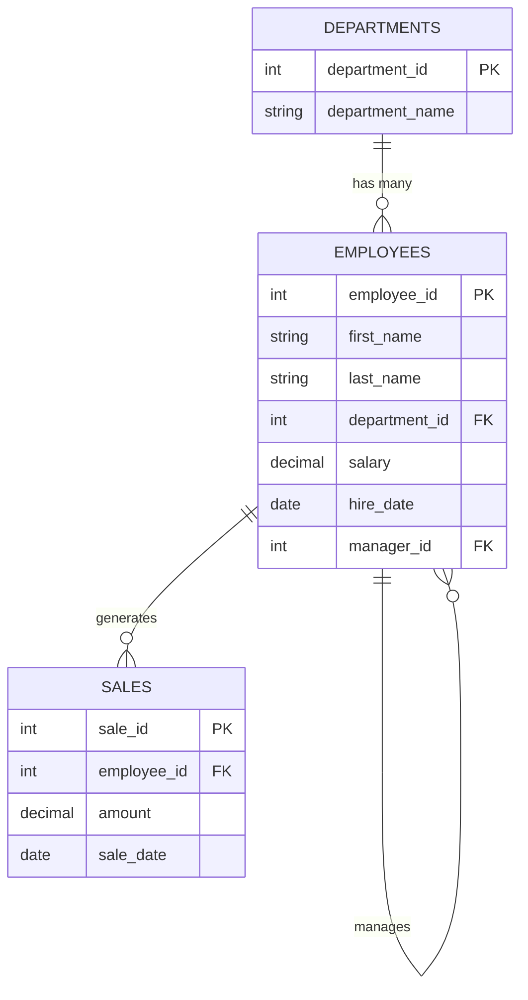
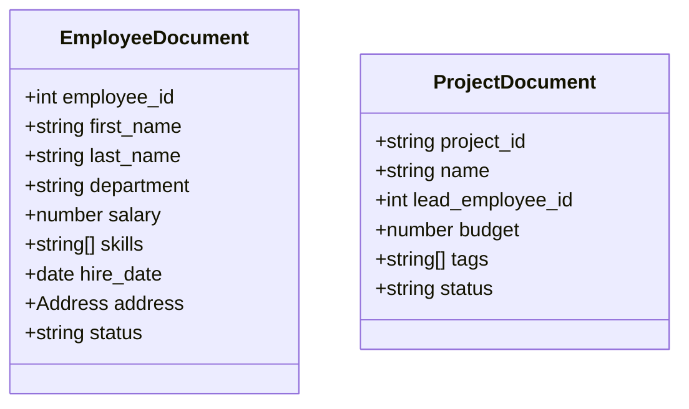

# 🚀 Database & SQL Interview Practice Lab

A zero-setup, containerized sandbox environment powered by **Docker**, **PostgreSQL 16**, **MongoDB 7.0**, **Redis 7**, and **PostGraphile (GraphQL Engine)**, pre-populated with realistic schemas and datasets to master technical database interview questions from beginner to advanced levels.

---

## 🛠️ Prerequisites

1. **[Docker Desktop](https://www.docker.com/products/docker-desktop/)** (version 20+ with Docker Compose v2+).
2. **Code Editor** (VS Code or any IDE).
3. **Web Browser** (to access the pre-configured Web GUIs and playgrounds).

---

## ⚡ Quick Start (Docker Compose)

Start only the services you need using Docker Compose profiles:

```bash
# Option A: Start SQL ONLY (PostgreSQL 16 + PGWeb GUI)
docker compose --profile sql up -d

# Option B: Start NoSQL Document DB ONLY (MongoDB 7.0)
docker compose --profile nosql up -d

# Option C: Start In-Memory Cache ONLY (Redis 7 + RedisInsight GUI)
docker compose --profile redis up -d

# Option D: Start GraphQL API ONLY (PostgreSQL + GraphiQL IDE)
docker compose --profile graphql up -d

# Option E: Start the ENTIRE sandbox environment simultaneously
docker compose --profile all up -d
```

To stop containers at any time:
```bash
docker compose down
```

---

## 🌐 Integrated Web GUIs (Zero Desktop Client Installation)

You do not need to install local desktop database clients (like DBeaver or Compass):

| Service | Engine | Web Access URL | Description |
| :--- | :--- | :--- | :--- |
| **PGWeb Client** | PostgreSQL | 👉 **[http://localhost:8081](http://localhost:8081)** | Lightweight web query editor for real-time SQL execution |
| **GraphiQL IDE** | GraphQL | 👉 **[http://localhost:5000/graphiql](http://localhost:5000/graphiql)** | Interactive GraphQL playground with autocomplete & docs |
| **RedisInsight** | Redis | 👉 **[http://localhost:5540](http://localhost:5540)** | Visual key-value inspector, data types, and memory analyzer |

---

## 📚 Study Tracks & Dedicated Guides

The curriculum is modularized into independent, step-by-step guides featuring theory, examples, interactive challenges, and solutions:

| Technology | 📖 Step-by-Step Study Guide | 💻 Runnable Practice Script |
| :--- | :--- | :--- |
| **SQL (PostgreSQL)** | [Complete SQL Guide](docs/SQL_GUIDE.md) | [`sql_practice.sql`](sql_practice.sql) |
| **NoSQL (MongoDB)** | [Complete MongoDB Guide](docs/NOSQL_GUIDE.md) | [`mongo_practice.js`](mongo_practice.js) |
| **In-Memory Cache (Redis)** | [Complete Redis Guide](docs/REDIS_GUIDE.md) | [`redis_practice.redis`](redis_practice.redis) |
| **GraphQL Engine** | [Complete GraphQL Guide](docs/GRAPHQL_GUIDE.md) | [`graphql_practice.graphql`](graphql_practice.graphql) |

---

## 🐘 Connection Credentials

For connecting via VS Code extensions or external tools:

#### PostgreSQL (Relational)
* **Host:** `localhost` | **Port:** `5432`
* **Username:** `admin` | **Password:** `adminpassword`
* **Database:** `interview_db`

#### MongoDB (NoSQL Document Store)
* **Host:** `localhost` | **Port:** `27017`
* **Username:** `admin` | **Password:** `adminpassword`
* **Database:** `interview_nosql` (authSource: `admin`)

#### Redis (In-Memory Key-Value & Cache)
* **Host:** `localhost` | **Port:** `6379`
* **Web GUI:** `http://localhost:5540`

#### GraphQL Engine (PostGraphile)
* **HTTP Endpoint:** `http://localhost:5000/graphql`
* **GraphiQL Playground:** `http://localhost:5000/graphiql`

---

## 📊 Database Schema Diagrams (ERD)

### PostgreSQL Relational Schema (`interview_db`)



* **Built-in Interview Edge Cases:** Department `'Marketing'` (id 5) has 0 employees (tests `LEFT JOIN` and `COUNT(*)` vs `COUNT(id)`); salary ties exist in Department 2 (tests `RANK` vs `DENSE_RANK`); root leaders have `manager_id IS NULL` (tests hierarchical Self-Joins and `COALESCE`).

---

### MongoDB Document Schema (`interview_nosql`)



---

## 💻 Ways to Run Queries

### 1. Via Web Browser (Recommended)
Open **[http://localhost:8081](http://localhost:8081)** and copy-paste queries from [`sql_practice.sql`](sql_practice.sql).

### 2. Via Terminal CLI
```bash
# PostgreSQL CLI
docker exec -it sql_interview_postgres psql -U admin -d interview_db

# MongoDB Shell
docker exec -it nosql_interview_mongo mongosh -u admin -p adminpassword

# Redis CLI
docker exec -it cache_interview_redis redis-cli
```

---

## 🌟 Repository Structure

```text
├── docs/
│   ├── SQL_GUIDE.md           <- Step-by-step SQL guide (Levels 1 to 5 with challenges)
│   ├── NOSQL_GUIDE.md         <- MongoDB guide (Pipelines, arrays, subdocuments, lookup)
│   ├── REDIS_GUIDE.md         <- Redis guide (Strings, hashes, sets, zsets, TTL)
│   └── GRAPHQL_GUIDE.md       <- GraphQL guide (Queries, nested relations, mutations)
├── sql_init/
│   └── 01_schema_and_data.sql <- Automatic PostgreSQL initialization script
├── mongo_init/
│   └── 01_init_nosql.js       <- Automatic MongoDB initialization script
├── redis_init/
│   └── 01_init.redis          <- Automatic Redis initialization commands
├── sql_practice.sql           <- Runnable interactive script with all SQL queries
├── mongo_practice.js          <- Runnable MongoDB queries script
├── redis_practice.redis       <- Runnable Redis CLI commands script
├── graphql_practice.graphql   <- Collection of queries for GraphiQL
├── docker-compose.yml         <- Multi-profile container orchestration
└── README.md                  <- Main repository portal and entrypoint
```
