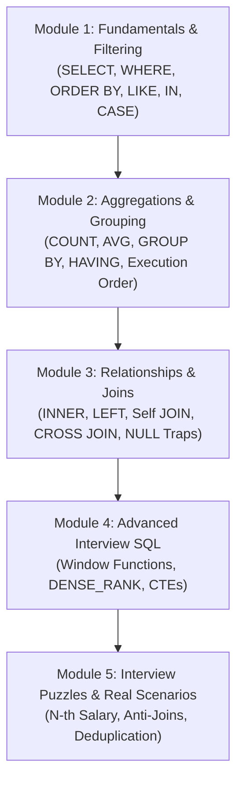

# 🐘 Complete SQL Guide: From Zero to Technical Interview

Welcome to the **Progressive Practical SQL Guide**. This curriculum is designed to teach you SQL step-by-step using the real schema and seed datasets already loaded into your PostgreSQL container (`interview_db`).

Each module includes:
1. **Conceptual explanation and syntax.**
2. **Runnable example** against the lab database.
3. **🎯 Interactive Challenges** with collapsible solutions (`<details>`).
4. **⚠️ Interview Traps:** Gotchas, edge cases, and trick questions commonly asked in technical screenings.

---

## 🧭 Learning Roadmap



---

## 📊 Lab Database Schema

All exercises query these three relational tables:

* **`departments`**: `department_id`, `department_name`
* **`employees`**: `employee_id`, `first_name`, `last_name`, `department_id`, `salary`, `hire_date`, `manager_id`
* **`sales`**: `sale_id`, `employee_id`, `amount`, `sale_date`

> 💡 **How to practice:** Open your browser client at **[http://localhost:8081](http://localhost:8081)** or run queries via VS Code or terminal CLI (`docker exec -it sql_interview_postgres psql -U admin -d interview_db`).

---

## 📌 Module 1: Fundamentals & Data Filtering

### 1.1 `SELECT`, `FROM`, and Column Projection
The `SELECT` clause specifies the columns you want to retrieve, and `FROM` identifies the target table.

```sql
-- Retrieve first names, last names, and salaries
SELECT first_name, last_name, salary 
FROM employees;
```

---

### 1.2 `WHERE` and Comparison Operators
The `WHERE` clause filters rows meeting one or more boolean criteria (`=`, `!=`, `>`, `<`, `>=`, `<=`).

```sql
-- Employees earning more than $80,000
SELECT first_name, salary 
FROM employees 
WHERE salary > 80000;
```

---

### 1.3 `BETWEEN`, `IN`, `LIKE`, and `IS NULL`
* **`BETWEEN min AND max`**: Inclusive range filter.
* **`IN (val1, val2)`**: Matches any value in a defined list.
* **`LIKE '%pattern%'`** / **`ILIKE`**: Pattern matching (`%` matches zero or more characters, `_` matches a single character). In PostgreSQL, `ILIKE` is case-insensitive.
* **`IS NULL` / `IS NOT NULL`**: Strict null checks (never use `= NULL`).

```sql
-- Employees in departments 1 and 2 hired between 2021 and 2022
SELECT first_name, department_id, hire_date 
FROM employees 
WHERE department_id IN (1, 2)
  AND hire_date BETWEEN '2021-01-01' AND '2022-12-31';

-- Employees without a direct manager
SELECT first_name, last_name 
FROM employees 
WHERE manager_id IS NULL;
```

---

### 1.4 `ORDER BY` and `LIMIT`
* **`ORDER BY column [ASC|DESC]`**: Sorts result sets ascending (default) or descending.
* **`LIMIT n`**: Constrains the number of returned rows.

```sql
-- Top 3 highest-earning employees in the company
SELECT first_name, salary 
FROM employees 
ORDER BY salary DESC 
LIMIT 3;
```

---

### 1.5 Conditional Logic with `CASE WHEN`
Creates computed columns based on conditional expressions (SQL equivalent of `if / else`).

```sql
SELECT 
    first_name,
    salary,
    CASE 
        WHEN salary >= 85000 THEN 'High Tier'
        WHEN salary >= 70000 THEN 'Mid Tier'
        ELSE 'Entry Tier'
    END AS salary_bracket
FROM employees;
```

---

### 🎯 Module 1 Challenges

#### Challenge 1.1: Employee Search
> **Question:** Return the full name (aliased as `full_name`), department ID, and hire date for all employees earning between `$60,000` and `$80,000`, ordered from newest hire to oldest.

<details>
<summary>🔍 View Solution 1.1</summary>

```sql
SELECT 
    first_name || ' ' || last_name AS full_name,
    department_id,
    hire_date
FROM employees
WHERE salary BETWEEN 60000 AND 80000
ORDER BY hire_date DESC;
```
</details>

#### Challenge 1.2: Seniority Classification
> **Question:** Display the employee's first name and a computed column named `seniority_status` showing `'Senior'` if hired before `2021-01-01`, and `'Recent'` otherwise.

<details>
<summary>🔍 View Solution 1.2</summary>

```sql
SELECT 
    first_name,
    hire_date,
    CASE 
        WHEN hire_date < '2021-01-01' THEN 'Senior'
        ELSE 'Recent'
    END AS seniority_status
FROM employees
ORDER BY hire_date ASC;
```
</details>

> ⚠️ **Interview Trap:**  
> In SQL, comparing with `NULL` using `= NULL` or `!= NULL` always yields `UNKNOWN` (falsy). You must always use `IS NULL` or `IS NOT NULL`.

---

## 📌 Module 2: Aggregations, Grouping & Logical Order of Execution

### 2.1 Aggregate Functions (`COUNT`, `SUM`, `AVG`, `MIN`, `MAX`)
Perform calculations on a set of rows and return a single summary value.

```sql
SELECT 
    COUNT(*) AS total_employees,
    ROUND(AVG(salary), 2) AS average_salary,
    MIN(salary) AS min_salary,
    MAX(salary) AS max_salary,
    SUM(salary) AS total_payroll
FROM employees;
```

---

### 2.2 `GROUP BY` and `HAVING`
* **`GROUP BY`**: Collapses rows with identical values in specified columns into summary rows.
* **`HAVING`**: Filters grouped rows **after** aggregation is performed.

```sql
-- Departments with more than 1 employee and their average salary
SELECT 
    department_id,
    COUNT(*) AS employee_count,
    ROUND(AVG(salary), 2) AS avg_salary
FROM employees
GROUP BY department_id
HAVING COUNT(*) > 1
ORDER BY avg_salary DESC;
```

---

### 2.3 🧠 SQL Logical Order of Execution
Although you write `SELECT` first, the database query engine executes clauses in the following order:

| Step | Clause | Purpose |
| :--- | :--- | :--- |
| **1** | `FROM` / `JOIN` | Locates source tables and performs joins |
| **2** | `WHERE` | Filters rows **before** aggregation |
| **3** | `GROUP BY` | Collapses rows into groups |
| **4** | `HAVING` | Filters aggregated groups |
| **5** | `SELECT` | Computes column expressions and creates aliases |
| **6** | `DISTINCT` | Deduplicates rows |
| **7** | `ORDER BY` | Sorts the final result set |
| **8** | `LIMIT / OFFSET` | Slices the specified pagination window |

> ⚠️ **Classic Interview Question:** *"Why can't I use an alias defined in `SELECT` inside the `WHERE` clause?"*  
> **Answer:** Because `WHERE` runs at **Step 2**, while `SELECT` (where the alias is defined) is not evaluated until **Step 5**.

---

### 🎯 Module 2 Challenges

#### Challenge 2.1: Employee Sales Summary
> **Question:** Query the `sales` table to find the `employee_id`, count of recorded sales transactions (`total_transactions`), accumulated sales revenue (`total_revenue`), and average sale amount per transaction. Only include employees whose total revenue exceeds `$3,000`.

<details>
<summary>🔍 View Solution 2.1</summary>

```sql
SELECT 
    employee_id,
    COUNT(*) AS total_transactions,
    SUM(amount) AS total_revenue,
    ROUND(AVG(amount), 2) AS avg_ticket
FROM sales
GROUP BY employee_id
HAVING SUM(amount) > 3000
ORDER BY total_revenue DESC;
```
</details>

---

## 📌 Module 3: Table Relationships and JOINs

### 3.1 Table Aliases (`AS` or Shorthand)
Writing full table names repeatedly (e.g., `employees.first_name`, `departments.department_name`) is tedious and clutters queries. **Table aliases** provide short, temporary nicknames for tables within a query.

#### Syntax & Comparison:
You assign an alias immediately after the table name in the `FROM` or `JOIN` clause (the `AS` keyword is optional and usually omitted for table aliases):

```sql
-- Without aliases (verbose):
SELECT employees.first_name, employees.last_name, departments.department_name
FROM employees
INNER JOIN departments ON employees.department_id = departments.department_id;

-- With aliases (clean, professional, and idiomatic):
SELECT e.first_name, e.last_name, d.department_name
FROM employees e
INNER JOIN departments d ON e.department_id = d.department_id;
```

#### Why Table Aliases are Essential:
1. **Readability & Conciseness:** Eliminates repetitive boilerplate in multi-table queries.
2. **Column Disambiguation:** When joined tables share columns with the same name (such as `department_id`, `id`, or `created_at`), prefixes like `e.department_id` vs `d.department_id` prevent the ambiguous column error.
3. **Mandatory for Self-Joins:** When joining a table to itself (Section 3.4), SQL requires distinct aliases (e.g., `employees e` and `employees m`) to distinguish each instance.

---

### 3.2 `INNER JOIN` (Intersection)
Returns rows that have matching values in **both** tables.

```sql
SELECT 
    e.first_name,
    e.last_name,
    d.department_name
FROM employees e
INNER JOIN departments d ON e.department_id = d.department_id;
```

---

### 3.3 `LEFT JOIN` (Left Outer Join)
A `LEFT JOIN` returns **all rows from the left table**, along with matched rows from the right table. If a row in the left table has no matching record in the right table, SQL populates all columns from the right table with `NULL`.

#### Comparison with `INNER JOIN`:
In our database, department **`Marketing` (ID 5)** has **0 employees**.
* An `INNER JOIN` completely omits `'Marketing'` from the result because there is no matching employee.
* A `LEFT JOIN` preserves `'Marketing'`, setting employee columns to `NULL`.

```sql
-- List all departments and any associated employees
SELECT 
    d.department_name,
    e.first_name,
    e.last_name
FROM departments d
LEFT JOIN employees e ON d.department_id = e.department_id;
```

> 💡 **Result Observation:**  
> Notice how `'Marketing'` is included in the output with `NULL` for `first_name` and `last_name`. This makes `LEFT JOIN` essential whenever you need to preserve the primary list (departments, customers, products) regardless of whether they have related records (employees, orders, reviews).

---

### 3.4 The Classic `LEFT JOIN` Trap: `COUNT(*)` vs `COUNT(col)`
When combining `LEFT JOIN` with `GROUP BY` and aggregations, a very common interview mistake occurs:

```sql
SELECT 
    d.department_name,
    COUNT(*) AS erroneous_count,           -- Returns 1 (counts the NULL row!)
    COUNT(e.employee_id) AS correct_count  -- Returns 0 (ignores NULLs)
FROM departments d
LEFT JOIN employees e ON d.department_id = e.department_id
GROUP BY d.department_name;
```

> ⚠️ **Interview Trap:**  
> `COUNT(*)` counts physical rows regardless of content. Because `'Marketing'` generated 1 row in the join (with `NULL` values), `COUNT(*)` counts it and returns **`1`** (incorrect).  
> `COUNT(e.employee_id)` evaluates the specific column and skips `NULL` entries, correctly returning **`0`**. Always count the right table's primary key (`COUNT(right_table.id)`) after a `LEFT JOIN`.

---

### 3.5 `Self JOIN` (Joining a Table to Itself)
Used to model hierarchical trees or compare records within the same table. Requires distinct aliases.

#### Case A: Employee $\rightarrow$ Manager Hierarchy
```sql
SELECT 
    e.first_name AS employee,
    COALESCE(m.first_name, 'No Manager') AS manager
FROM employees e
LEFT JOIN employees m ON e.manager_id = m.employee_id;
```

#### Case B: Finding Unique Pairs without Duplicates (`id < id`)
To pair employees sharing the same department without reverse duplicates (A with B and B with A):

```sql
SELECT 
    e1.first_name AS employee_1,
    e2.first_name AS employee_2,
    e1.department_id
FROM employees e1
INNER JOIN employees e2 
    ON e1.department_id = e2.department_id
   AND e1.employee_id < e2.employee_id;
```

---

### 3.6 `CROSS JOIN` (Cartesian Product)
Combines each row of the first table with **all** rows of the second table ($N \times M$). It does not use an `ON` clause.

```sql
-- Generate a matrix of every employee crossed with every department
SELECT 
    e.first_name, 
    d.department_name
FROM employees e
CROSS JOIN departments d;
```

---

### 🎯 Module 3 Challenges

#### Challenge 3.1: Employee Sales Roster (Including Zero Sales)
> **Question:** Generate a report listing the employee's full name, department name, and total sales revenue. If an employee has recorded zero sales, display `$0.00`.

<details>
<summary>🔍 View Solution 3.1</summary>

```sql
SELECT 
    e.first_name || ' ' || e.last_name AS employee,
    d.department_name,
    COALESCE(SUM(s.amount), 0.00) AS total_sales
FROM employees e
INNER JOIN departments d ON e.department_id = d.department_id
LEFT JOIN sales s ON e.employee_id = s.employee_id
GROUP BY e.employee_id, e.first_name, e.last_name, d.department_name
ORDER BY total_sales DESC;
```
</details>

---

## 📌 Module 4: Advanced Interview SQL

### 4.1 Window Functions
Unlike `GROUP BY` (which collapses rows), window functions compute aggregate values over partitions while **preserving every individual row**.

* **`ROW_NUMBER()`**: Sequential integer assignment (1, 2, 3, 4) ignoring ties.
* **`RANK()`**: Identical ranks for ties, but **skips ranks** (1, 2, 2, 4).
* **`DENSE_RANK()`**: Identical ranks for ties **without skipping ranks** (1, 2, 2, 3).

```sql
SELECT 
    first_name,
    department_id,
    salary,
    ROW_NUMBER() OVER (PARTITION BY department_id ORDER BY salary DESC) AS row_num,
    RANK() OVER (PARTITION BY department_id ORDER BY salary DESC) AS rnk,
    DENSE_RANK() OVER (PARTITION BY department_id ORDER BY salary DESC) AS dense_rnk
FROM employees;
```

---

### 4.2 Common Table Expressions (`CTEs` with `WITH`)
CTEs create modular, human-readable temporary result sets that can be referenced in the main query.

```sql
-- Employees earning more than their own department's average salary
WITH DeptAverages AS (
    SELECT 
        department_id,
        AVG(salary) AS dept_avg_salary
    FROM employees
    GROUP BY department_id
)
SELECT 
    e.first_name,
    e.salary,
    ROUND(d.dept_avg_salary, 2) AS dept_avg
FROM employees e
JOIN DeptAverages d ON e.department_id = d.department_id
WHERE e.salary > d.dept_avg_salary;
```

---

### 🎯 Module 4 Challenges

#### Challenge 4.1: Top 2 Highest Paid Employees per Department
> **Question:** Find the top 2 highest salaries in each department. If two employees share the same salary, both must share the same rank using `DENSE_RANK()`.

<details>
<summary>🔍 View Solution 4.1</summary>

```sql
WITH RankedSalaries AS (
    SELECT 
        e.first_name,
        e.last_name,
        d.department_name,
        e.salary,
        DENSE_RANK() OVER (PARTITION BY e.department_id ORDER BY e.salary DESC) AS ranking
    FROM employees e
    JOIN departments d ON e.department_id = d.department_id
)
SELECT department_name, first_name, last_name, salary, ranking
FROM RankedSalaries
WHERE ranking <= 2
ORDER BY department_name, ranking;
```
</details>

---

## 📌 Module 5: Interview Puzzles & Real Scenarios

### 5.1 Finding the N-th Highest Salary (2nd Highest)

**Method 1: Using `DENSE_RANK()` (Recommended for interviews)**
```sql
WITH Ranked AS (
    SELECT salary, DENSE_RANK() OVER (ORDER BY salary DESC) AS rnk
    FROM employees
)
SELECT DISTINCT salary 
FROM Ranked 
WHERE rnk = 2;
```

**Method 2: Using `OFFSET` and `LIMIT`**
```sql
SELECT DISTINCT salary 
FROM employees 
ORDER BY salary DESC 
OFFSET 1 LIMIT 1;
```

---

### 5.2 Anti-Joins: Finding Orphaned Records
Find all departments that currently have **zero** assigned employees:

```sql
-- Method A: LEFT JOIN with IS NULL (Anti-Join)
SELECT d.department_name
FROM departments d
LEFT JOIN employees e ON d.department_id = e.department_id
WHERE e.employee_id IS NULL;

-- Method B: NOT EXISTS
SELECT d.department_name
FROM departments d
WHERE NOT EXISTS (
    SELECT 1 FROM employees e WHERE e.department_id = d.department_id
);
```

---

### 5.3 Finding & Managing Duplicates Across Different Table Types
Finding and handling duplicate records is one of the most frequently asked SQL interview questions and everyday data quality tasks. The strategy depends directly on the **type and structure of the table**:

| Table Type | Architectural Characteristics | Real-World Scenario | Best Approach |
| :--- | :--- | :--- | :--- |
| **1. Lookup / Catalog** | Single-column natural key | `departments`, `roles`, categories | `GROUP BY` + `HAVING` with `LOWER(TRIM(...))` |
| **2. Master Entity** | Surrogate PK with composite business keys | `employees`, `users`, customers | `ROW_NUMBER() OVER (PARTITION BY ...)` |
| **3. Transactional / Fact** | High-volume events, timestamps, money | `sales`, `orders`, payment logs | Window functions (`PARTITION BY` + `ORDER BY`) or `LAG()` |
| **4. Junction / Mapping** | Composite PK (N:M relationships) | `employee_projects`, `user_roles` | Self-JOIN or `GROUP BY` on composite keys |
| **5. Staging / Heap** | Raw imports, **no primary key**, 100% clones | ETL batches, CSV import staging | System row pointer (`ctid` in PostgreSQL) |

---

#### 1. Lookup & Catalog Tables (Dimension / Dictionary Tables)
* **Context:** Tables like `departments` or `categories` where a single descriptive column (e.g. `department_name`) should be unique.
* **Common Cause:** Human typo, inconsistent whitespace, or casing differences (`'Marketing'`, `'marketing'`, `'Marketing '`).

```sql
-- Step 1: Detect duplicate entries ignoring case and whitespace
SELECT 
    LOWER(TRIM(department_name)) AS normalized_name,
    COUNT(*) AS total_occurrences,
    ARRAY_AGG(department_id) AS conflicting_ids
FROM departments
GROUP BY LOWER(TRIM(department_name))
HAVING COUNT(*) > 1;

-- Step 2: Safe Deduplication (Keep the lowest ID and reassign children)
-- In production, reassign child foreign keys first before deletion:
-- UPDATE employees SET department_id = 1 WHERE department_id = 99;
DELETE FROM departments
WHERE department_id NOT IN (
    SELECT MIN(department_id)
    FROM departments
    GROUP BY LOWER(TRIM(department_name))
);
```

---

#### 2. Master Entity Tables (Composite Business Keys)
* **Context:** Tables like `employees` or `users` that possess a surrogate primary key (`employee_id`), but have business duplicates across multiple columns (e.g. identical `first_name` + `last_name`, or duplicate tax IDs / emails).
* **Objective:** Find duplicates and decide whether to preserve the **oldest record** (original registration) or the **latest record** (most updated profile).

```sql
-- Step 1: Quick count of duplicate employee names
SELECT 
    first_name, 
    last_name, 
    COUNT(*) AS occurrences
FROM employees
GROUP BY first_name, last_name
HAVING COUNT(*) > 1;

-- Step 2: Inspect full details of all duplicates (original vs clones)
WITH RankedEmployees AS (
    SELECT 
        employee_id,
        first_name,
        last_name,
        hire_date,
        salary,
        ROW_NUMBER() OVER (
            PARTITION BY first_name, last_name 
            ORDER BY hire_date ASC, employee_id ASC
        ) AS row_num
    FROM employees
)
SELECT * 
FROM RankedEmployees
WHERE row_num > 1; -- row_num = 1 is the original; row_num > 1 are the duplicates

-- Step 3: Delete redundant duplicates keeping only the earliest hire
WITH DuplicatesToDelete AS (
    SELECT employee_id
    FROM (
        SELECT 
            employee_id,
            ROW_NUMBER() OVER (
                PARTITION BY first_name, last_name 
                ORDER BY hire_date ASC, employee_id ASC
            ) AS row_num
        FROM employees
    ) ranked
    WHERE ranked.row_num > 1
)
DELETE FROM employees
WHERE employee_id IN (SELECT employee_id FROM DuplicatesToDelete);
```

---

#### 3. Transactional & Event Tables (Sales, Orders, Payments)
* **Context:** High-throughput event tables like `sales` where duplicates occur due to network retries, client double-clicks, or race conditions.
* **Objective:** Detect repeated transactions with matching `employee_id`, `amount`, and `sale_date`.

```sql
-- Step 1: Detect duplicate sales entries and calculate inflated revenue
SELECT 
    employee_id,
    amount,
    sale_date,
    COUNT(*) AS duplicate_count,
    SUM(amount) AS total_inflated_amount
FROM sales
GROUP BY employee_id, amount, sale_date
HAVING COUNT(*) > 1;

-- Step 2: Time-gap analysis (detect near-identical transactions within seconds/same day)
WITH SalesTimeline AS (
    SELECT 
        sale_id,
        employee_id,
        amount,
        sale_date,
        LAG(sale_date) OVER (
            PARTITION BY employee_id, amount 
            ORDER BY sale_date
        ) AS previous_sale_date
    FROM sales
)
SELECT * 
FROM SalesTimeline 
WHERE sale_date = previous_sale_date;
```

---

#### 4. Junction & Association Tables (Many-to-Many Relationships)
* **Context:** Tables like `employee_projects` or `user_roles` linking two entities. If a composite primary key `(employee_id, project_id)` was not enforced, identical relationship rows can occur.

```sql
-- Step 1: Detect duplicate pairings
SELECT 
    employee_id, 
    project_id, 
    COUNT(*) AS link_occurrences
FROM employee_projects
GROUP BY employee_id, project_id
HAVING COUNT(*) > 1;

-- Step 2: Keep only one pair using Self-JOIN or temporary deduplication
DELETE FROM employee_projects a
USING employee_projects b
WHERE a.ctid > b.ctid
  AND a.employee_id = b.employee_id
  AND a.project_id = b.project_id;
```

---

#### 5. Staging & Heap Tables (Raw Tables without Any Primary Key)
* **Context:** Raw ETL staging tables populated directly from CSV/JSON dumps where rows can be **100% identical across every column**, and there is no `id` column.
* **Problem:** In standard SQL, you cannot run `DELETE WHERE id IN (...)` because no primary key exists.
* **PostgreSQL Solution:** Use the internal physical tuple identifier **`ctid`**.

```sql
-- Delete exact full-row duplicates while keeping the first physical copy:
DELETE FROM staging_sales
WHERE ctid NOT IN (
    SELECT MIN(ctid)
    FROM staging_sales
    GROUP BY employee_id, amount, sale_date
);
```

---

### 🎯 Module 5 Challenges

#### Challenge 5.1: Duplicate Sales Hunter
> **Question:** Write a query against the `sales` table to identify if any employee has multiple sales transactions with the exact same `amount` on the exact same `sale_date`. Return `employee_id`, `sale_date`, `amount`, and the duplicate count.

<details>
<summary>🔍 View Solution 5.1</summary>

```sql
SELECT 
    employee_id,
    sale_date,
    amount,
    COUNT(*) AS duplicate_count
FROM sales
GROUP BY employee_id, sale_date, amount
HAVING COUNT(*) > 1
ORDER BY duplicate_count DESC;
```
</details>

#### Challenge 5.2: Employee Deduplication Action Plan
> **Question:** Generate an audit report for `employees` flagging each row with an action plan: `'KEEP'` for the original (earliest `hire_date`) or `'DELETE'` for duplicates sharing the same `department_id` and `salary`.

<details>
<summary>🔍 View Solution 5.2</summary>

```sql
WITH RankedEmployees AS (
    SELECT 
        employee_id,
        first_name,
        last_name,
        department_id,
        salary,
        hire_date,
        ROW_NUMBER() OVER (
            PARTITION BY department_id, salary 
            ORDER BY hire_date ASC, employee_id ASC
        ) AS duplicate_rank
    FROM employees
)
SELECT 
    employee_id,
    first_name,
    last_name,
    department_id,
    salary,
    CASE 
        WHEN duplicate_rank = 1 THEN 'KEEP'
        ELSE 'DELETE'
    END AS action_plan
FROM RankedEmployees
ORDER BY department_id, salary, duplicate_rank;
```
</details>

---

## 🎯 Best Practices for Technical Interviews
1. **Always anticipate `NULL` values:** Before answering what a query returns, verify how nulls are handled.
2. **Prefer `DENSE_RANK()` over `LIMIT 1 OFFSET 1`** when asked for the "N-th highest salary", because ties can produce unexpected results with offset limits.
3. **Favor CTEs (`WITH`) over nested subqueries** in the `FROM` clause; readability and clean modularity are heavily rewarded.
4. **Beware of `COUNT(*)` in `LEFT JOIN`:** Always count the foreign table's primary key (`COUNT(right_table.id)`).
5. **Never rely on `DISTINCT` to fix duplicate bugs:** In interviews, explain that `DISTINCT` hides underlying join or data modeling issues; always identify the root cause using `GROUP BY ... HAVING COUNT(*) > 1` or `ROW_NUMBER()`.
